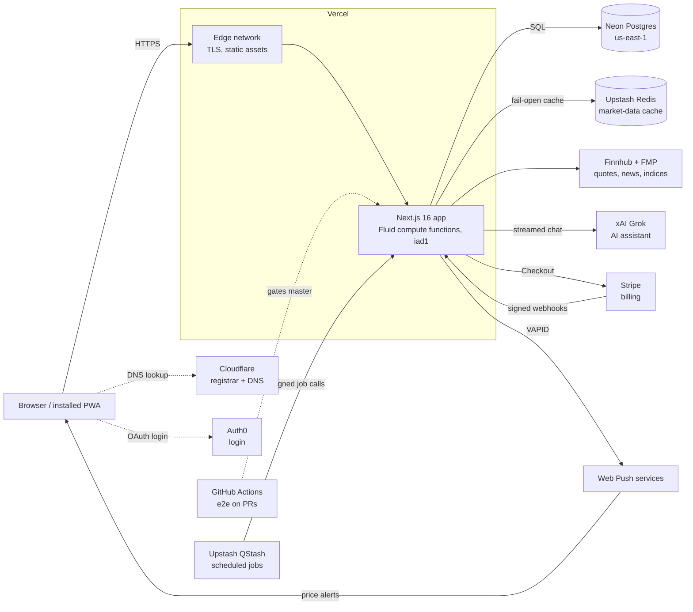

# StockMind AI

An AI-powered stock research and analysis dashboard built on top of a simulated mini-brokerage backend. StockMind AI lets users explore live market data, manage watchlists, place simulated trades, track portfolio performance, and receive real-time price alerts via web push notifications.

> Repository: [ohadfefer/stockmind-ai](https://github.com/ohadfefer/stockmind-ai)

---

## Features

- **Live market data** — real-time quotes, company profiles, news, and search via Finnhub.
- **Simulated brokerage** — buy/sell orders, executions, positions, cash ledger, and deposits/withdrawals, all persisted in Postgres.
- **Portfolio tracking** — per-position P&L, day change, portfolio weight, and daily position snapshots for historical performance.
- **Watchlists** — multiple named lists per account (e.g. "Tech Picks", "Earnings Watch") with per-symbol notes.
- **Price alerts** — `price_above`, `price_below`, `earnings`, and `ai_signal` conditions, evaluated by a signed QStash webhook and delivered through Web Push.
- **Missed-alerts inbox** — triggered alerts the user hasn't seen yet, surfaced in a bell dropdown and dismissed on read.
- **News feed** — general market news and per-symbol company news.
- **Account area** — balance, transfer history, and position history snapshots.
- **Auth** — Auth0 login/signup with an onboarding step that captures the user's full name.
- **Pro subscriptions** — Stripe-powered Checkout for upgrading to StockMind Pro, with a first-party billing page (card on file, invoice history, cancel at period end); webhook-synced subscription state mirrored into Postgres.
- **Installable PWA** — works as a Progressive Web App: installable to the home screen / desktop and launchable full-screen, with Web Push delivered through a service worker.

---

## Architecture



Cloudflare only answers DNS: the records are DNS-only, so traffic goes straight to Vercel's edge. Stripe and QStash reach the app through the same public URL as browsers. From June to November 2026 the app ran on AWS ECS Fargate instead; that setup is documented under [Previous deployment: AWS](#previous-deployment-aws-ecs-fargate).

---

## Engineering Highlights

- **Atomic trade settlement.** Filling an order claims it, writes the execution and the cash-ledger entry, and updates the position in one SERIALIZABLE Postgres transaction, retried on serialization failures and deadlocks. → [Orders](#orders)
- **Append-only, idempotent cash ledger.** Balances are never updated in place, and a partial unique index means a retried request can't record the same cash movement twice. → [Database](#database)
- **Fail-open shared cache.** Market data is cached in Upstash Redis and shared by every function instance. A Redis command gets 2 s at most, a failure bypasses Redis for 15 s, and concurrent requests for the same symbol share one fetch. With Redis down, every page still renders. → [Caching](#caching)
- **Auth enforced at build time.** A prebuild script fails the build if any API method skips an auth wrapper, and every error response uses one RFC 9457 problem+json format. → [API Documentation](#api-documentation)
- **SSRF guard on push.** A push subscription's endpoint must belong to a known push service (FCM, Mozilla, WNS, Apple), so the server never sends requests to a URL an attacker supplied. → [Push subscriptions](#push-subscriptions)
- **Gated deploys.** Playwright e2e tests run against an isolated Neon branch, as a database role that exists only there. Merging into `master` requires a passing run, and only `master` deploys to production. → [Testing](#testing)
- **Ran on AWS, then moved back for cost.** For five months the app ran as ARM64 containers on ECS Fargate behind an ALB reachable only through Cloudflare's IP ranges, with secrets from SSM and an EventBridge-scheduled Lambda. At ~$60 a month for a portfolio app it moved back to Vercel. That move meant making the code serverless-safe: no work after the response without `after()`, a connection pool that releases before the instance suspends, and streams that end inside the function limit. → [Deployment](#deployment)

---

## Tech Stack

**Framework & Language**
- [Next.js 16](https://nextjs.org) (App Router) with React 19 and TypeScript
- Tailwind CSS v4 with CSS variables for theming
- [shadcn/ui](https://ui.shadcn.com) (new-york style) on top of Radix UI primitives
- [Lucide](https://lucide.dev) icons and [Recharts](https://recharts.org) for charts

**Backend & Data**
- [Neon Serverless Postgres](https://neon.tech) via `@neondatabase/serverless`
- [Auth0](https://auth0.com) via `@auth0/nextjs-auth0` v4
- [Stripe](https://stripe.com) for subscription billing — Checkout and webhooks (`stripe` Node SDK)
- [Finnhub](https://finnhub.io) for live quotes, profiles, news, and market status
- [FMP](https://financialmodelingprep.com) (free plan) for the dashboard's market-index bar
- [xAI Grok](https://x.ai) (`grok-4-1-fast-reasoning`) via the [Vercel AI SDK](https://sdk.vercel.ai) (`ai` + `@ai-sdk/xai`) for the AI assistant and portfolio review
- [Upstash QStash](https://upstash.com/qstash) for signed, scheduled webhooks that drive the background jobs (alert checker + position snapshots)
- [Upstash Redis](https://upstash.com/redis) via `@upstash/redis` (REST) as the shared market-data cache — quotes, profiles, market status, the index bar; see [Caching](#caching)
- [web-push](https://github.com/web-push-libs/web-push) + VAPID keys for browser push notifications
- [@vercel/analytics](https://vercel.com/docs/analytics) for page analytics

**Infrastructure & Deployment**
- [Vercel](https://vercel.com) — Git-integrated deploys (production from `master`, previews for pull requests), Fluid compute functions pinned to `iad1` (us-east-1, beside Neon)
- [Cloudflare](https://www.cloudflare.com) as registrar and DNS (DNS-only records pointing at Vercel)
- [GitHub Actions](https://docs.github.com/actions) — the e2e suite on every pull request, required by the `master` ruleset

*Previously, June–November 2026 — kept in the repo, see [Previous deployment: AWS](#previous-deployment-aws-ecs-fargate):*
- [Docker](https://www.docker.com) multi-stage build → Next.js standalone image (`node:22-slim`, non-root, ARM64)
- [Amazon ECR](https://aws.amazon.com/ecr/) registry + [Amazon ECS on Fargate](https://aws.amazon.com/fargate/) (ARM64/Graviton) for hosting
- [Application Load Balancer](https://docs.aws.amazon.com/elasticloadbalancing/) + [ACM](https://aws.amazon.com/certificate-manager/) for HTTPS, proxied through Cloudflare
- [SSM Parameter Store](https://docs.aws.amazon.com/systems-manager/latest/userguide/systems-manager-parameter-store.html) (SecureString) for runtime secrets; [CloudWatch Logs](https://aws.amazon.com/cloudwatch/) for container logs
- [EventBridge Scheduler](https://docs.aws.amazon.com/scheduler/) + [Lambda](https://aws.amazon.com/lambda/) for the daily position snapshot
- GitHub Actions CD — build, push to ECR, and roll the ECS service on every push to `master`

**Tooling**
- ESLint (`eslint-config-next`)
- `shadcn` CLI for component scaffolding

---

## Prerequisites

- **Node.js** — a version compatible with Next.js 16 (Node 20+ recommended)
- **npm** (the repo uses `package-lock.json`)
- **Git**
- Accounts / credentials for:
  - Auth0 tenant (with a Regular Web Application configured)
  - Neon Postgres project
  - Finnhub API key
  - [xAI](https://x.ai) API key (powers the Grok-based AI assistant and portfolio review)
  - Upstash QStash (signing keys, plus a schedule for the background jobs)
  - Upstash Redis database (the free tier is plenty) for the market-data cache — optional: without it the app falls back to calling Finnhub on every render
  - VAPID key pair for Web Push (generate with `npx web-push generate-vapid-keys`)
  - Stripe account (test mode is sufficient for local dev) and the [Stripe CLI](https://stripe.com/docs/stripe-cli) for forwarding webhooks to localhost
  - For deployment: a [Vercel](https://vercel.com) account — optional for local dev. ([Docker](https://www.docker.com) builds the image from the archived AWS setup.)

---

## Getting Started

```bash
# 1. Clone
git clone https://github.com/ohadfefer/stockmind-ai.git
cd stockmind-ai

# 2. Install dependencies (all app code lives under frontend/)
cd frontend
npm install

# 3. Configure environment
#    Create frontend/.env.local and fill in the variables listed below.
#    This file is gitignored — never commit it.

# 4. Run database migrations against your Neon database
#    Apply each file in /migrations in order (001 → 028; 009 does not exist).
#    They are plain SQL — run them via psql, the Neon SQL editor,
#    or any Postgres client.

# 5. Start the dev server
npm run dev
# → http://localhost:3000
```

On first login you'll be routed through `/onboarding` to capture your name and investing profile, which calls `POST /api/onboarding` and inserts rows into `users` and `user_profiles` plus a default brokerage account. If that account creation fails it is not fatal — every read path provisions one lazily.

---

## Project Structure

```
stockmind-ai/
├── CLAUDE.md                 # Repo conventions / agent context
├── .github/
│   └── workflows/
│       ├── deploy.yml        # Archived AWS pipeline (manual-only) — ARM64 image → ECR → ECS
│       └── e2e.yml           # Playwright e2e suite on every pull request into master
├── migrations/               # Plain .sql files — schema of record (run manually)
│   ├── 001_create_users.sql  # …through 028, applied in filename order.
│   └── ...                   # 009 does not exist; the gap is historical.
└── frontend/                 # Next.js app — all code lives here
    ├── Dockerfile            # Multi-stage build → Next.js standalone image (ARM64, non-root) — from the AWS setup
    ├── .dockerignore         # Keeps secrets (.env*) and build artifacts out of the image
    ├── next.config.ts        # standalone output (for Docker) + baseline security headers
    ├── vercel.json           # Pins functions to iad1, beside Neon; no crons — QStash drives the jobs
    ├── playwright.config.ts  # E2E config — own dev server on the e2e Neon branch, production guard
    ├── e2e/                  # Playwright tests — Auth0 login setup + one spec per flow
    ├── scripts/
    │   ├── check-route-auth.mjs  # prebuild gate — every API method must use an auth wrapper
    │   └── seed-demo.ts          # Reseeds the shared demo account
    ├── public/
    │   ├── sw.js             # Service worker for Web Push
    │   └── ...               # Icons, placeholder assets
    └── src/
        ├── proxy.ts          # Next.js 16 proxy — Auth0 middleware + route protection
        ├── app/
        │   ├── layout.tsx    # Root layout (Auth0Provider, Vercel Analytics)
        │   ├── page.tsx      # Public landing at / — redirects logged-in users to /dashboard
        │   ├── manifest.ts   # PWA manifest, served at /manifest.webmanifest
        │   ├── globals.css
        │   ├── (auth)/       # Centered layout — login, signup, onboarding
        │   └── (main)/       # Dashboard shell — sidebar + header
        │       ├── dashboard/         # Main dashboard
        │       ├── portfolio/         # Holdings, orders, trade, alerts tabs
        │       ├── watchlist/         # Watchlists
        │       ├── news/              # Market & per-symbol news
        │       ├── details/[symbol]/  # Stock detail page
        │       ├── account/           # Balance, transfers, history
        │       ├── settings/          # User preferences (notifications, strategy profile, payments)
        │       ├── conversation/      # AI assistant chat
        │       └── api/               # Route handlers — see API Documentation
        ├── components/
        │   ├── ui/           # shadcn/ui primitives — do not manually edit
        │   ├── dashboard/    # Dashboard widgets
        │   ├── portfolio/    # Portfolio tabs and tables
        │   ├── watchlist/    # Watchlist UI
        │   ├── details/      # Stock detail widgets
        │   ├── alerts/       # Alerts table + missed-alerts bell
        │   ├── account/      # Account tabs
        │   ├── settings/     # Settings panes (notifications, strategy/ profile editor, subscription/)
        │   ├── profile/      # Investing-profile options, choice cards and interest grid — shared by onboarding and settings
        │   ├── sidebar.tsx
        │   └── header.tsx
        ├── actions/          # Client-side API calls (named exports), all via actions/http.ts
        ├── services/         # Server-side data-fetching functions
        │   ├── ai/           # xAI/Grok conversation, portfolio-review, title, cost services
        │   ├── alerts/       # alerts-service, alert-checker-service, missed-alerts-service
        │   ├── dashboard/    # sector, index, and watchlist aggregates
        │   ├── position/     # position-service, position-history-service
        │   ├── settings/     # per-pane page-data loaders (strategy-page-data)
        │   ├── stripe/       # stripe-service, webhook-service, subscription-service, billing-service, cancellation-service
        │   └── ...           # user, account, order, execution, transfer, stock, watchlist, push-subscription, notification
        ├── hooks/            # Custom React hooks (use-mobile, use-notifications, use-toast)
        ├── lib/              # auth0, db (Neon), redis (Upstash), finnhub, fmp, format, symbol, push-endpoint, utils
        │   └── http/         # problem.ts (RFC 9457), with-auth.ts, public-routes.ts, read-json-body.ts
        ├── types/            # Ambient type declarations
        └── styles/           # Additional global styles
```

### Conventions

These conventions come from `CLAUDE.md` — please follow them when adding code:

- **Services** — server-side data fetching lives in `src/services/<domain>-service.ts`, not inside page files. Pages import from services and focus on rendering.
- **Actions** — client-side API calls (POST, DELETE, etc.) live in `src/actions/<domain>.ts` as named functions (e.g. `createAlert`, `submitOrder`, `dismissMissedAlerts`). Components call these instead of making inline `fetch` calls, and the actions themselves go through `apiFetch`/`apiSend` in `src/actions/http.ts` rather than bare `fetch` — see [API Documentation → Conventions](#conventions-1).
- **Route handlers** — every exported method wraps itself in `withAuth`, `withUser` or `withAccount`, and returns errors through the `src/lib/http/problem.ts` helpers. `npm run prebuild` fails the build otherwise.
- **shadcn/ui** — add components via `npx shadcn@latest add <name>` from `frontend/`. Do not manually edit files in `src/components/ui/`.
- **Path alias** — `@/*` maps to `frontend/src/*`.
- **Route groups** — `(auth)` and `(main)` do not affect URLs; they only scope layouts.

---

## Available Scripts

Run from `frontend/`:

```bash
npm run dev        # Start the Next.js dev server on localhost:3000
npm run build      # Production build (runs prebuild first)
npm run prebuild   # Route-auth gate — fails if any API method skips an auth wrapper
npm run start      # Start the production build
npm run lint       # Run ESLint
npm run seed:demo  # Reseed the shared demo account
npm run test:e2e   # Playwright end-to-end tests (starts its own dev server)
npm run test:e2e:ui  # Same, in Playwright's interactive runner
```

`prebuild` runs `scripts/check-route-auth.mjs`, which walks every `route.ts` under `src/app/(main)/api/` and asserts each exported HTTP method is wrapped in `withAuth`/`withUser`/`withAccount`, unless its path is listed in `src/lib/http/public-routes.ts`. It checks **methods, not files** — a file whose `GET` is wrapped and whose newly added `DELETE` is a bare `export async function` is exactly the mistake worth catching. It also flags an allowlisted path with no route file behind it, so the exemption list cannot accumulate entries a future route would silently inherit. Vercel runs `npm run build` for every deployment (as did the Docker build on AWS), so nothing ships past the gate.

---

## Testing

End-to-end tests live in `frontend/e2e/` and run with [Playwright](https://playwright.dev) in Chromium. They log in through the real Auth0 tenant as a dedicated test user and run against a separate Neon branch, so they never write to the production database.

```bash
npm run test:e2e             # Run the suite headless
npm run test:e2e:ui          # Interactive runner
npx playwright show-report   # Open the HTML report of the last run
```

### One-time setup

1. `npx playwright install chromium` — downloads the browser.
2. Sign up a dedicated test user through the app against the production database and finish onboarding, so its `users` row is in production when the `e2e` branch copies it. Put its credentials in `.env.local` as `E2E_EMAIL` and `E2E_PASSWORD`.
3. In the Neon console, create a child branch of production named `e2e`. A child branch, not an empty one, so it starts with production's schema and the test user. If the branch already exists, reset it from its parent after step 2 instead. Either way the branch now holds a copy of every user's data, which the tests don't need and the e2e credentials shouldn't reach: on the `e2e` branch, run `DELETE FROM users WHERE id <> <test user's id>`. Every table cascades from `users`, so that leaves only the test user's rows.
4. On the `e2e` branch, add a role named `e2e_runner` (Neon console → select the `e2e` branch → Roles → Add role). Put the branch's pooled connection string **for that role** in `.env.local` as `E2E_DATABASE_URL`. Don't use the default `neondb_owner`: a branch copies its parent's roles with their passwords, so that string would log in to production too. `e2e_runner` exists only on this branch.

### How a run works

- `npm run test:e2e` starts its own `next dev` on `:3000` with `DATABASE_URL` set to `E2E_DATABASE_URL`. Stop your own dev server first: Playwright refuses to reuse one, since it talks to production, and Next 16 allows only one `next dev` per folder anyway.
- `playwright.config.ts` refuses to run if `E2E_DATABASE_URL` is missing, logs in as any role but `e2e_runner`, or points at the same Neon endpoint as `DATABASE_URL`.
- The `setup` project (`e2e/auth.setup.ts`) logs in once per run through Auth0's hosted page and saves the session to `playwright/.auth/user.json`. Every other test starts from that session, except `logged-out.spec.ts`.
- The data-changing specs (`watchlist`, `trading`, `alerts`, `settings`) each use their own symbol or resource, so they run in parallel, and undo their writes through the API before or after each test. `trading.spec.ts` deposits $10,000 when the test user's cash is under $1,000 (deposits are limited to one per 72 h). `alerts.spec.ts` stubs `PushManager.prototype.subscribe`, because creating an alert first subscribes the browser to push.
- Not covered: the AI assistant and portfolio review, Stripe checkout, push delivery and the QStash jobs.

`playwright/.auth/`, `playwright-report/` and `test-results/` are gitignored. Treat them as secrets: the saved session and any failure trace hold a live session cookie.

### In CI

`.github/workflows/e2e.yml` runs the suite on every pull request into `master` and on demand (`workflow_dispatch`). Pull requests from forks are skipped: GitHub gives them no secrets, so they couldn't log in.

- Runs queue in one `e2e` concurrency group across all branches, and one in progress is never cancelled. Every run shares the test user and the `e2e` branch, so two at once would undo each other's writes. For the same reason, don't run the suite locally while CI is running it.
- `forbidOnly` fails the run if a `test.only` was committed.
- No report or trace is uploaded. They hold a live session cookie, and anyone signed in to GitHub can download a public repo's artifacts. A failure is read from the job log.
- The job gets only what the app needs to serve the pages under test. Redis, xAI, Stripe, FMP, VAPID and QStash stay out: the app runs without them and no spec depends on them. Redis above all, since its token can write the production cache. Without it, each render calls Finnhub directly.

**Required repository secrets:**

| Secret | Value |
| --- | --- |
| `E2E_DATABASE_URL` / `E2E_EMAIL` / `E2E_PASSWORD` | Same as in `.env.local` |
| `AUTH0_DOMAIN` / `AUTH0_CLIENT_ID` / `AUTH0_CLIENT_SECRET` | The Auth0 application whose callbacks allow `http://localhost:3000` (the one `.env.local` uses) |
| `E2E_AUTH0_SECRET` | A fresh `openssl rand -hex 32`. It only encrypts the run's session cookie, so it must never be production's `AUTH0_SECRET`: that one can forge sessions on the live site |
| `FINNHUB_API_KEY` | Same as in `.env.local` |

### Migrations and the e2e branch

Apply each new migration to the `e2e` branch first, run `npm run test:e2e`, then apply it to production. That way the migration is tested before it reaches production.

Don't use "Reset from parent" to bring `e2e` up to date. A reset copies production over the whole branch, roles included, so it deletes `e2e_runner` and `E2E_DATABASE_URL` stops working. Keep the reset for when the branch's data gets into a bad state, then delete the other users' data again (setup step 3), add `e2e_runner` again, update `E2E_DATABASE_URL` with its new password, and re-apply any migration that isn't in production yet.

---

## Environment Variables

**Local development** reads these from `frontend/.env.local` (gitignored — never commit real secrets). **In production** they are Vercel environment variables, scoped to the Production environment (see [Deployment](#deployment)). The only build-time variable is the public VAPID key; everything else is read at runtime. On AWS the same values lived in SSM Parameter Store — see [Previous deployment: AWS](#previous-deployment-aws-ecs-fargate).

### Application

| Variable        | Description                                                                       |
| --------------- | --------------------------------------------------------------------------------- |
| `APP_BASE_URL`  | Base URL of the app — `http://localhost:3000` in dev, `https://getstockmind.com` in production. |

### Auth0

| Variable              | Description                                            |
| --------------------- | ------------------------------------------------------ |
| `AUTH0_DOMAIN`        | Your Auth0 tenant domain (`*.auth0.com`).              |
| `AUTH0_CLIENT_ID`     | Auth0 application client ID.                           |
| `AUTH0_CLIENT_SECRET` | Auth0 application client secret.                       |
| `AUTH0_SECRET`        | Session encryption secret (32+ random bytes).          |

### Database — Neon Postgres

| Variable       | Description                                                  |
| -------------- | ------------------------------------------------------------ |
| `DATABASE_URL` | Pooled (`-pooler` host) Neon Postgres connection string used by the app. |

`DATABASE_URL` is the only database variable the app reads (`src/lib/db.ts`, which `npm run seed:demo` also goes through). The e2e suite's `E2E_DATABASE_URL` (see [End-to-end tests](#end-to-end-tests)) never reaches the app under its own name: Playwright passes it to its test server as `DATABASE_URL`. The `PG*`, `POSTGRES_*` and `DATABASE_URL_UNPOOLED` variables that Vercel's Neon integration used to inject are unused. The Neon project lives in `aws-us-east-1`, the same region as the Vercel functions (`iad1`, pinned in `vercel.json`): every query is a network round trip, so keep the two together.

### Market Data

| Variable          | Description                                                         |
| ----------------- | ------------------------------------------------------------------- |
| `FINNHUB_API_KEY` | Finnhub API key — required for quotes, search, profiles, news.     |
| `FMP_API_KEY`     | Financial Modeling Prep key — used by the dashboard's index bar.   |

### AI — xAI Grok

| Variable       | Description                                                                                  |
| -------------- | -------------------------------------------------------------------------------------------- |
| `XAI_API_KEY`  | xAI API key — used by the Vercel AI SDK (`@ai-sdk/xai`) for the Grok assistant / portfolio review. |

### Upstash QStash

| Variable                     | Description                                              |
| ---------------------------- | -------------------------------------------------------- |
| `QSTASH_URL`                 | QStash base URL for publishing messages.                 |
| `QSTASH_TOKEN`               | QStash auth token for publishing.                        |
| `QSTASH_CURRENT_SIGNING_KEY` | Current signing key used to verify inbound QStash calls. |
| `QSTASH_NEXT_SIGNING_KEY`    | Next signing key for seamless rotation.                  |

All three scheduled jobs verify the QStash signature with the two signing keys. The app no longer reads `CRON_SECRET`; it was the bearer token the AWS Lambda sent to the snapshot job.

### Upstash Redis

| Variable                   | Description                                                                 |
| -------------------------- | --------------------------------------------------------------------------- |
| `UPSTASH_REDIS_REST_URL`   | REST endpoint of the Upstash Redis database (used by `@upstash/redis`).     |
| `UPSTASH_REDIS_REST_TOKEN` | REST token for that database (server only).                                 |

Back the shared market-data cache — see [Caching](#caching). Both are optional: the cache fails open, so with them unset (or pointing at a dead database) the app still serves every page, just with a Finnhub call per render.

### Web Push Notifications

| Variable                      | Description                                                                           |
| ----------------------------- | ------------------------------------------------------------------------------------- |
| `NEXT_PUBLIC_VAPID_PUBLIC_KEY` | VAPID public key (exposed to the browser to register push subscriptions). Inlined at **build time** — locally via `.env.local`, in prod from the Vercel environment, so changing it needs a redeploy. (The Docker image takes it as a build arg.) |
| `VAPID_PRIVATE_KEY`            | VAPID private key (server only) used to sign push payloads via `web-push`.           |

### Stripe (Subscriptions)

| Variable                | Description                                                                                                                                          |
| ----------------------- | ---------------------------------------------------------------------------------------------------------------------------------------------------- |
| `STRIPE_SECRET_KEY`     | Stripe secret API key (server only). Use a test-mode `sk_test_...` for local dev.                                                                    |
| `STRIPE_PRICE_ID`       | Price ID of the Pro plan (`price_...`) used as the line item in Checkout.                                                                            |
| `STRIPE_WEBHOOK_SECRET` | Signing secret used to verify `POST /api/stripe/webhook` payloads. In dev, the `whsec_...` printed by `stripe listen`; in prod, the endpoint secret. |

### End-to-end tests

| Variable           | Description                                                                                                  |
| ------------------ | ------------------------------------------------------------------------------------------------------------ |
| `E2E_DATABASE_URL` | Pooled connection string of the `e2e` Neon branch, for its `e2e_runner` role. Must not be the production endpoint — the config checks. |
| `E2E_EMAIL`        | Email of the dedicated Auth0 test user.                                                                      |
| `E2E_PASSWORD`     | That user's password.                                                                                        |

Read only by `npm run test:e2e`: locally from `.env.local`, in CI from repository secrets — see [Testing](#testing). Never set them in production.

---

## Database

The schema of record is the set of plain SQL files in `/migrations/`. They are applied manually against Neon (via `psql` or the Neon SQL editor). Each file is idempotent where possible (`IF NOT EXISTS`).

High-level model:

- **users** — one row per Auth0 identity (`auth0_id` is unique).
- **accounts** — brokerage accounts; a user can own more than one (e.g. "growth", "dividends").
- **cash_ledger** — append-only cash movements. Never `UPDATE`/`DELETE`; `running_balance` gives O(1) balance reads.
- **orders** / **executions** / **positions** / **position_history** — trade instructions, fills, materialized holdings, and daily snapshots that power portfolio charts.
- **transfers** — deposits/withdrawals; on completion a matching row is appended to `cash_ledger`.
- **watchlists** / **watchlist_items** — named lists of symbols, scoped per account.
- **stock_alerts** — price/earnings/AI alerts (enum `alert_condition` + `alert_status`).
- **push_subscriptions** — Web Push endpoints registered per user.
- **missed_alerts** — triggered alerts the user hasn't acknowledged, dismissed when the bell dropdown is read.
- **subscriptions** — Stripe-mirrored billing rows (one per Stripe subscription). `users.subscription_plan` and `users.stripe_customer_id` are denormalized for hot-path reads; the table is the audit trail synced from webhooks.

There is no migration `009`. No file with that prefix exists anywhere in the repository's history — it is a numbering gap, not a deleted or pending migration.

---

## Caching

Market data is cached in **Upstash Redis** over its REST API (`@upstash/redis`), so every request, every poll and every function instance reads one shared copy instead of each instance warming its own from Finnhub or FMP. `src/lib/redis.ts` owns the client and the fail-open wrapper. Two modules read and write it: `src/services/stock/quote-cache.ts` for the Finnhub data, and `src/services/dashboard/index-service.ts` for the dashboard's FMP index bar.

### Fail-open by construction

Nothing in the cache is a source of truth. Every operation goes through `redisTry(label, op)`, which turns **any** failure — timeout, network, Upstash error, missing credentials — into `undefined`, and `undefined` reads exactly like a miss: the caller goes to Finnhub (or FMP) and the page renders either way. `null` stays reserved for "key not found".

Three details make that cheap during an outage:

- **A 2s budget per command, with one retry inside it.** The SDK evaluates the `signal` function once while building the request and shares that signal across the retry, and an abort rethrows instead of retrying — so a lookup is capped at ~2s end to end, and the retry only buys a second try at a fast failure like a dropped socket. A cache read must never wait longer than the Finnhub call it is trying to avoid. (Left at the SDK default it would be 6 attempts with exponential backoff — ~4.3s of sleeping on top of the attempts themselves.)
- **A 15s process-local breaker.** After a failure, Redis is skipped entirely for 15 seconds, so an outage costs one timeout per window rather than one per lookup, and logs once instead of one stack trace per symbol.
- **Lazy client.** `getRedis()` builds on first use, like `getDb()` — `next build` imports route modules without the runtime env, and a top-level client would throw on the missing URL. The single shared instance also matters for throughput: the SDK auto-pipelines per client, so the 2N GETs a dashboard render issues in one tick leave as one HTTP request.

### Keys

| Key | Value | Expiry (`EX`) | Treated as fresh for |
| --- | ----- | ------------- | -------------------- |
| `market-status:US` | `{ isOpen, fetchedAt }` | 1 h | 30 s |
| `quote:{SYMBOL}` | `{ quote, marketWasOpen, fetchedAt }` | 7 d — but 5 min for a zeroed quote | 60 s while the market is open; 3 h while closed, and only if the snapshot was itself taken while closed |
| `profile:{SYMBOL}` | `{ profile, fetchedAt }` | 7 d | 24 h |
| `index-quotes` | `{ quotes: [{ …IndexQuote, fetchedAt }], checkedAt }` | 24 h | 15 min from the last refresh *attempt* (`checkedAt`); a symbol FMP fails on keeps its last quote for up to 24 h |

**Freshness comes from `fetchedAt`, not from the key's expiry.** The two can't be collapsed. The closed-market rule turns on *how* the snapshot was taken (`marketWasOpen`) and not just how old it is, and a Finnhub failure falls back to whatever is cached *however old it is* — so an entry has to outlive the window in which it counts as fresh. The `EX` values are a garbage-collection ceiling for symbols nobody looks at any more, nothing else.

**Why a closed-market quote still ages out after 3 h.** `marketWasOpen` alone can't carry the decision: a snapshot taken after Monday's close still reads as "taken while closed" on Tuesday evening, so without an age bound it would be served in place of Tuesday's close for as long as the key lived, whenever nobody happened to load that symbol during Tuesday's session. Nothing else writes `quote:*` — the alert checker, the snapshot job, `/api/stocks/quote` and order execution all call Finnhub directly, so no background process refreshes the key on the app's behalf. The bound has to be short enough that a snapshot can never outlive a close it predates; the tightest gap is the last pre-open moment (09:30 ET, which still reads closed) to an **early-close half-day** at 13:00 ET, so three hours sits under that 3h30m. Six hours looks fine against a normal 16:00 close and is wrong on half-days.

**Why zeroed quotes expire in 5 minutes.** Finnhub answers an unknown or delisted ticker with `200` and `c: 0` (plus `null` `d`/`dp`), so `finnhubFetch` can't reject on it. In a shared cache those zeros would otherwise be handed to every user for a week; the short expiry still spares an API call per render for a dead ticker parked on someone's watchlist.

**Why the index bar is one entry on a 15-minute clock.** The dashboard's bar is nine FMP `/quote` calls, one per index, and FMP's free plan allows 250 calls a day. So the bar is cached whole: a render reads one key. Freshness is age alone, with no market-status rule, because the Nikkei, Hang Seng, FTSE and STOXX 50 trade while New York is closed. Fifteen minutes is comfortably under the quota at this app's traffic, but not under continuous traffic (96 windows × 9 calls = 864); a 1-hour window is the one that would hold under any load. Two rules make running out harmless:

- **The window restarts on every attempt, not every success.** A refresh that fails outright still stamps `checkedAt`, so an FMP outage or a spent quota costs nine failing calls per window instead of per render.
- **A failed symbol keeps its last quote for up to 24 h.** Each quote carries its own `fetchedAt`, so one index FMP stops answering for doesn't blank the bar, and a spent quota leaves the last values up until it resets. The 24 h bound means a symbol FMP stops serving for good drops off the bar instead of freezing on it — and since nothing older is ever served, it's also the key's `EX`.

### What stays in the process

- **In-flight request coalescing.** `quote-cache.ts` keeps a pending promise per symbol for quotes and profiles (two `Map`s) plus a single one for market status, so concurrent callers share one load — a pending promise can't be handed through Redis. Each promise covers the Redis read as well as the Finnhub fetch, so a caller arriving during the round-trip (or in the gap between Finnhub's answer and the write-back) joins it instead of starting its own. The quote map is keyed `${symbol}:${marketOpen}`, because a promise can settle *from cache* under whichever rule its originator was applying: around the opening bell two callers can disagree about the market for up to 30s, and the one that thinks it's open must not inherit a pre-market snapshot the closed rule waved through. `index-service.ts` keeps one more for the index bar, so concurrent renders on an expired entry share one round of FMP calls.
- **Not positions.** `getPositions` reads Neon on every call. It used to keep a 60s per-process cache that the executions route cleared after a trade, but Next loads pages and route handlers through separate runtimes, each with its own copy of the module — the clear reached the route handlers' copy while the portfolio page served pre-trade holdings from its own until the TTL ran out, and a second function instance would miss it the same way. A process-local cache is only safe for data no write has to invalidate.

---

## API Documentation

All route handlers live under `frontend/src/app/(main)/api/`. The API is resource-shaped: collections are plural nouns, identifiers live in the path rather than the request body, and the method carries the verb. Read three endpoints and you can predict the rest.

### Conventions

**Identifiers in the path.** `DELETE /api/alerts/42`, not `DELETE /api/alerts { alertId: 42 }`. Every handler that takes an id scopes its SQL by `account_id` as well, so a guessed or borrowed id matches zero rows rather than someone else's data.

**Status codes carry meaning.**

| Code | Used for |
| --- | --- |
| `200` | A read, or a write whose updated representation the caller needs. |
| `201` | Something was created. Carries `Location` except where the request URI already names it (`PUT`), or the created resource has no URL of its own (`POST /api/orders/{id}/executions`). |
| `202` | Accepted but not finished — only `POST /api/transfers`. `Location` points at a status monitor. |
| `204` | Success with nothing to say — deletes, and writes whose caller reads no body. |

**One error shape.** Every session-protected route returns [RFC 9457](https://www.rfc-editor.org/rfc/rfc9457) `application/problem+json`:

```json
{
  "type": "https://getstockmind.com/problems/order_not_pending",
  "title": "Conflict",
  "status": 409,
  "detail": "The order is no longer pending, so it cannot be cancelled.",
  "code": "order_not_pending"
}
```

`code` is the stable machine-readable discriminator — clients switch on it, never on `title` or `detail`. `type` is derived from `code` so the two cannot drift. Extension members (`nextAllowedAt`, `spent`, …) ride alongside for the errors that carry data. Helpers live in `src/lib/http/problem.ts`.

| `code` | Status | Meaning |
| --- | --- | --- |
| `invalid_request` | 400 | Missing field, wrong type, unparseable body. |
| `unauthenticated` | 401 | No session cookie, or it expired. |
| `ai_budget_exceeded` | 402 | AI allowance spent. Extensions: `spent`, `budget`. |
| `onboarding_required` | 403 | Valid session, no `users` row yet. Client routes to `/onboarding`. |
| `not_found` | 404 | Missing — or not the caller's. The two are deliberately indistinguishable. |
| `order_not_pending` | 409 | The order already filled or was cancelled. |
| `subscription_active` | 409 | Already subscribed; checkout refused before Stripe charges anything. |
| `no_active_subscription` | 409 | Nothing to cancel. |
| `payload_too_large` | 413 | Body exceeded 64 KiB. Only on routes that read through `readJsonBody` — see below. |
| `no_upcoming_earnings` | 422 | Well-formed, but the symbol has no scheduled report. |
| `no_push_subscriptions` | 422 | Well-formed, but no device is registered to receive a push. |
| `transfer_cooldown_active` | 429 | Inside the 72h window. Extensions: `nextAllowedAt`, `remainingMs`. |
| `internal_error` | 500 | Unhandled. The cause is logged server-side, never returned. |
| `upstream_failed` | 502 | Finnhub/xAI/Stripe failed or returned something unusable. Retryable. |

**Authentication is per route, not just at the edge.** Every handler is wrapped in one of three ladders from `src/lib/http/with-auth.ts`, and `npm run prebuild` (`scripts/check-route-auth.mjs`) fails the build if any exported method is not:

- `withAuth` — session only.
- `withUser` — resolves `userId`; returns `onboarding_required` when there is no `users` row.
- `withAccount` — resolves `accountId`, **provisioning the default account if absent**.

Provisioning is a property of the resolver rather than the wrapper, which is the part worth knowing when adding a route: `withAccount` and `getAccountDetails` both call `getOrCreateDefaultAccount` and write, while `getDefaultAccountId` returns `null` for an account that doesn't exist. Reads that run on a timer or on mount take the last of those — `/api/missed-alerts`, `/api/transfers/cooldown` and `GET /api/push-subscriptions/{id}` — so a 60s poll never conjures an account and a watchlist for a user who never asked for one. `GET /api/watchlists` and the two `/api/portfolio/*` reads provision on purpose: it is how a first-visit user gets their default list and cash balance.

The only handlers exempt from a wrapper are the five self-authenticating routes listed in `src/lib/http/public-routes.ts`, which verify a signature or shared secret themselves.

**Body size is capped where it is read through `readJsonBody`.** `src/lib/http/read-json-body.ts` streams and counts bytes, aborting past 64 KiB — `request.json()` buffers the whole body before any field-level check can run, and Next caps Server Actions and proxy-read bodies but not a route handler, while Vercel's own request limit (4.5 MB) is far above 64 KiB. The auth wrapper answers the resulting `PayloadTooLargeError` with `413`, so the size rule lives beside the session and onboarding rules rather than being re-typed in every handler. **It is not yet universal:** the three conversation routes, `/api/onboarding` and `/api/profile` use it; the seven other write routes still call `request.json()` directly.

**Clients go through `src/actions/http.ts`.** `apiFetch` / `apiSend` / `apiRequest` check `res.ok`, parse the problem body into a thrown `ApiError` (`status`, `code`, `detail`, `extra`), and route a `401`/`onboarding_required` to the right page. Background pollers opt out of the navigation with `redirectOnAuthFailure: false`.

### Authentication

Auth0 v4 SDK auto-registers the standard routes under `/auth/*`:

- `GET /auth/login` — start login
- `GET /auth/logout` — end session
- `GET /auth/callback` — Auth0 callback
- `GET /auth/profile` — current user profile

An unauthenticated request is handled by `proxy.ts`: page navigations get a `307` to `/`, but anything under `/api/*` gets the same `401 unauthenticated` problem+json a handler would return — so an expired session during an XHR is indistinguishable from any other auth failure, instead of arriving as `200 text/html`.

### Onboarding

- `POST /api/onboarding` → **204**. Creates the `users` row, the default account, and the profile; marks onboarding complete.
  Body: `{ fullName, experienceLevel, motivation, interests: string[], investorStyle, engagementCadence }`
  The one route on `withAuth` rather than `withUser` — it is what *creates* the user row, so "no user row yet" is its normal state.

### Profile

The caller's investing profile (the five onboarding answers), a singleton per user — so no id in the path. On `withUser`, not `withAccount`: it hangs off the `users` row and editing it must not provision a brokerage account.

- `PATCH /api/profile` → `{ experienceLevel, motivation, interests, investorStyle, engagementCadence, updatedAt }`.
  Body: any subset of `{ experienceLevel, motivation, interests: string[], investorStyle, engagementCadence }` — Settings → Strategy edits one answer at a time, so only the fields present change. An empty body is `400`; unknown interest values are dropped rather than rejected, as onboarding does. **404** when the user has no profile row.
  No `GET`: the settings page renders the profile server-side. Both this route and `/api/onboarding` validate through `parseProfileFields` in `user-profile-service.ts`, so the allowed values live in one place.

### Market data (Finnhub proxies)

All on `withAuth`: market data is not account state, and a quote lookup must not provision an account as a side effect. An upstream failure is `502`, not `500`.

- `GET /api/stocks/quote?symbol=AAPL` → Finnhub quote payload.
- `GET /api/stocks/search?q=apple` → **`application/x-ndjson`**, streamed so the matches render before their prices. First line `{ type: "matches", matches: [{ symbol, displaySymbol, description }] }` (top 5 US listings), then, with `quotes=true`, one `{ type: "quote", symbol, quote: { price, changePercent } | null }` per match as each resolves from the shared quote cache (`null` when Finnhub has no quote). Without it the body is the matches line alone, and no quote or market-status lookup is made — the news search needs only the symbols. A failed search is a plain `502` problem, since nothing has streamed yet. `q` is required and capped at 64 characters.
- `GET /api/stocks/trades?symbol=AAPL` → **`text/event-stream`** of live trade ticks, proxied off Finnhub's websocket. Consumed by `EventSource`, which sends same-origin cookies but cannot set headers; a `401` surfaces as `onerror`. A function can't outlive `maxDuration` (300 s), so the server ends each stream at 280 s and `EventSource` reconnects on its own; the client gives up only when the browser reports the connection `CLOSED` (a refusal) or the server sends an error event.
- `GET /api/stocks/upcoming-earnings?symbol=AAPL` → the next scheduled report. **404** when the symbol has nothing on the calendar — callers that treat that as normal opt in with `allowStatus: [404]`.

### Portfolio

- `GET /api/portfolio/summary` → `{ runningBalance, portfolioValue, totalPL, totalPLPercent, todayPL, todayPLPercent, holdings[], marketOpen }`. Polled every 60s while the US market is open.
- `GET /api/portfolio/trading-info` → `{ cashBalance, positions: [{ symbol, quantity }] }` — what the trade form needs for its affordability checks.

### Orders

- `POST /api/orders` → **201** `{ id }`, `Location: /api/orders/{id}`. Creates a **pending** order; nothing settles yet.
  Body: `{ symbol, side: "buy"|"sell", orderType: "market"|"limit"|"stop"|"stop_limit", quantity, averageFillPrice, filledAt }`
  Every field is re-validated server-side — the trade forms are not a trust boundary, and a negative quantity would invert the cash sign at settlement.
- `PATCH /api/orders/{id}` → `{ id, status: "cancelled" }`. Body: `{ "status": "cancelled" }` — the only supported transition. Cancellation is a status change rather than a `DELETE` because the row survives it.
  **409 `order_not_pending`** for every miss, including an id that does not exist or is not the caller's: splitting out a `404` would answer "does this id exist" for ids the caller does not own, and 409 is the useful answer for the case that actually happens — cancelling an order that just filled.
- `POST /api/orders/{id}/executions` → **201** `{ id }` (the execution id). Settles the order at the current quote, then writes the execution, cash-ledger and position rows.
  The body is ignored entirely; the symbol, side and quantity come from the order row. No `Location`: the created resource is an execution, and executions have no URL of their own, so pointing at the parent order would name a different resource than the one created (RFC 9110 §15.3.2).

There is no `GET` on either collection — `/portfolio/orders` renders server-side from `getOrdersByAccountId`.

### Transfers

- `POST /api/transfers` → **202** `{ id, status: "pending" }`, `Location: /api/transfers/{id}`.
  Body: `{ direction: "deposit"|"withdrawal", amount, method, description? }`
  202 rather than 201: the transfer row exists, but the money has not moved — resolution runs ~10s later, in an `after()` callback so the serverless function stays alive for it. `Location` is the status monitor RFC 9110 §15.3.3 asks a 202 to provide, and the account panel polls it until `status` leaves `pending` rather than waiting a fixed delay.
  **429 `transfer_cooldown_active`** when inside the 72h window. The gate lives inside the `INSERT` itself, so two concurrent posts cannot both find a clear window.
- `GET /api/transfers/{id}` → `{ id, direction, amount, method, status, description, initiatedAt, completedAt }`
- `GET /api/transfers/cooldown` → `{ lastInitiatedAt, nextAllowedAt, remainingMs }`. A property of the account's transfer history, not of any one transfer, so it stays a sibling of the collection.

### Watchlists

`{id}` accepts the literal **`default`**, which resolves to the account's *oldest* list — deliberately not the one named "General", since every list can be renamed and deleted. That is what lets `/details/[symbol]` follow a stock without first fetching a list id.

- `GET /api/watchlists[?symbol=AAPL]` → `[{ id, name, itemCount, containsSymbol? }]`
  `?symbol=` **annotates** each row rather than filtering: the picker has to render the lists that *don't* hold the symbol as unchecked boxes, so a parameter that dropped those rows would be a filter wearing an annotation's name.
- `POST /api/watchlists` → **201** `{ id, name }`, `Location: /api/watchlists/{id}`. Body: `{ name }` (≤ 60 chars).
- `PATCH /api/watchlists/{id}` → `{ id, name }`. Body: `{ name }`.
- `DELETE /api/watchlists/{id}` → **204**. Cascades to the list's items.
- `PUT /api/watchlists/{id}/items/{symbol}` → **201** + `Location` when the symbol is new to the list, **204** when it was already there. Membership is a resource the client can name, so re-adding is idempotent because `PUT` is — not because the handler special-cases it.
- `DELETE /api/watchlists/{id}/items/{symbol}` → **204**, whether or not the symbol was there. Only the list itself missing earns a 404.

### Alerts

- `POST /api/alerts` → **201** with the created alert, `Location: /api/alerts/{id}`.
  Body: `{ symbol, condition: "price_above"|"price_below"|"earnings"|"ai_signal", targetValue }`
  `targetValue` must be a positive finite number; it is omitted for `earnings`, which instead resolves the symbol's next report date. **422 `no_upcoming_earnings`** when there isn't one — the request was well formed, the symbol just has nothing to hang an alert on.
- `DELETE /api/alerts/{id}` → **204**. A non-integer segment and another account's id both get the same 404.
- `GET /api/missed-alerts` → `[{ id, symbol, condition, target_value, triggered_price, created_at }]` — triggered alerts the user hasn't acknowledged. Polled every 60s by the header bell.
- `DELETE /api/missed-alerts` → **204**. `DELETE` on a collection URI empties it: the "seen them, clear the badge" action.

Missed alerts are their own collection rather than a `?status=` filter on `/api/alerts` because they are a separate table (migration 013) with a different shape — `triggered_price`, and no `status` or `earnings_date` — so one filtered collection would have to return two row types.

There is no `GET /api/alerts`: the alerts table is server-rendered from `getAlerts`, and nothing fetches it over HTTP.

### Push subscriptions

`{id}` is **base64url of the subscription's endpoint URL** (`src/lib/push-endpoint.ts`). A hash would have needed a new column and a migration before a row could be looked up, and being one-way would have made the host allowlist unrepeatable once the endpoint left the client. The decoder re-encodes and compares before accepting an id, because Buffer's base64url decoder silently drops unrecognised characters — without that round trip, several distinct ids would name one subscription.

- `PUT /api/push-subscriptions/{id}` → **201** when the row is new, **204** when it already existed and the keys were refreshed (browsers rotate `p256dh`/`auth` for the same endpoint, which is an update, not a create).
  Body: `{ p256dh, auth }` · The decoded endpoint host must be on the allowlist (FCM, Mozilla, WNS, Apple) — otherwise it is an attacker-supplied URL that `web-push` would later POST to from inside the network.
- `DELETE /api/push-subscriptions/{id}` → **204** whether or not a row was there.
- `GET /api/push-subscriptions/{id}` → **204** registered, **404** not registered. No body: the row's contents are exactly what must never be echoed back.

An id that doesn't decode to an allowlisted endpoint is **400, not 404** — deliberately breaking with the alerts precedent. The client treats a problem+json 404 from the `GET` as authority to call `sub.unsubscribe()`, so a 404 must always mean "we looked and you have none", never "we could not read the id".

### AI conversations

- `POST /api/conversations` → **201** whose body is a **text stream**, plus `Location: /api/conversations/{id}` and `X-Conversation-Id: {id}`.
  Body: `{ content }` (non-empty, ≤ 4000 characters)
  The documented oddity. The tidier alternative — plain `201 { id }`, then a second POST to say something — puts a blocking round trip in front of the first token of every new chat, which is the one place in the app where time-to-first-token is the whole experience. The id still reaches the client via the header, because the body is occupied. Creation stays lazy, so visiting `/conversation` writes nothing and the history list never fills with empty threads.
- `POST /api/conversations/{id}/messages` → **200**, streaming the reply. Every turn after the first. No `Location` and no `X-Conversation-Id` — the id is the path the caller chose.
- `PATCH /api/conversations/{id}` → **204**. Body: `{ title?, pinned? }` — two independent optional fields, not a flag that switches the operation. Send either or both; a single `UPDATE` applies them so a two-field patch cannot half-apply. An empty patch is a 400.
- `DELETE /api/conversations/{id}` → **204**. Cascades to the thread's messages; the AI usage ledger is unaffected.

Both POSTs return **402 `ai_budget_exceeded`** (extensions `spent`, `budget`) when the caller's AI allowance is spent — 402 Payment Required is literal here, since the block clears by upgrading.

### Subscriptions / Billing

- `POST /api/stripe/checkout` → `{ url }` to redirect to. Reuses the saved `stripe_customer_id` so returning subscribers don't get a duplicate Stripe Customer. **409 `subscription_active`** if one is already active — refused *before* creating the session, otherwise Stripe charges the card and the webhook upsert later trips on the partial unique index.
- `POST /api/stripe/cancel` → **204**. Schedules the active subscription to cancel at `current_period_end`; Pro access is preserved until then. Writes `cancel_at_period_end` back locally so the settings page updates without waiting for the webhook echo. An already-scheduled cancellation is also 204 — it is the state the caller asked for. **409 `no_active_subscription`** when there is nothing to cancel.

#### Local development

In a separate terminal, forward Stripe events to the dev server with the [Stripe CLI](https://stripe.com/docs/stripe-cli):

```bash
stripe listen --forward-to localhost:3000/api/stripe/webhook
```

Copy the `whsec_...` it prints into `STRIPE_WEBHOOK_SECRET` in `frontend/.env.local`. Trigger lifecycle events with e.g. `stripe trigger checkout.session.completed` or `stripe trigger customer.subscription.deleted`.

### Public routes

The five paths in `src/lib/http/public-routes.ts` are reachable without an Auth0 session because each verifies its own caller. That array is the single source of truth for both the proxy allowlist and the build-time guard script, so the two cannot drift. It holds **exact paths only** — a prefix like `/api/jobs/` would silently exempt every future route in that subtree.

- `GET /api/health` — liveness probe returning `{ "status": "ok" }`. Used by the Docker `HEALTHCHECK` (and by the ALB target group on AWS). Does no I/O, so a slow dependency never marks the container unhealthy.
- `POST /api/jobs/snapshot-positions` — QStash schedule, same signature scheme as the alert checkers. Writes a daily `position_history` row for every open position and rolls them up into `portfolio_daily_value`. Runs on `30 21 * * 1-5` (weekdays 21:30 UTC, after US market close).
- `POST /api/alerts/check` — QStash webhook; Upstash signature verified against `QSTASH_CURRENT_SIGNING_KEY`/`QSTASH_NEXT_SIGNING_KEY`. Evaluates every active price alert, atomically claims triggered rows, sends pushes, reverts alerts whose every push failed, and records `missed_alerts` for the rest.
- `POST /api/alerts/check-earnings` — QStash webhook, same signature scheme. Triggers earnings alerts whose report date has arrived.
- `POST /api/stripe/webhook` — Stripe webhook; signature verified against `STRIPE_WEBHOOK_SECRET`, pinned to the Node runtime so the raw body can be read verbatim. Handles `checkout.session.completed`, `customer.subscription.updated` and `customer.subscription.deleted`; mirrors state into `subscriptions` and flips `users.subscription_plan` in a single transaction.

### Documented exceptions

Three, each deliberate:

1. **`POST /api/alerts/test-notification`** — the API's one RPC endpoint. It is an action, not a resource: there is no "test notification" entity to create. Sends a canned push to every subscription on the caller's account and returns `{ sent: n }`; **422 `no_push_subscriptions`** when there are none. Nothing in the app calls it — it exists to be hit with `curl` when verifying that a device's registration actually delivers, which is otherwise only observable by waiting for a real alert to fire.
2. **`POST /api/stripe/checkout` and `POST /api/stripe/cancel`** keep their verb-in-path shape. There is no Checkout Session or cancellation resource this app owns — Stripe does — so there is nothing here to name. They use the auth wrappers and problem+json like everything else.
3. **The five public routes return `{ "error": "..." }`, not problem+json.** Their consumers are QStash, Stripe and a health probe: none parse the body, all switch on status, and Stripe surfaces the raw body in its dashboard, where a `type` URL pointing at a page that doesn't exist would be worse than a plain string.

### Examples

```bash
# Create a price alert (session cookie required)
curl -i -X POST http://localhost:3000/api/alerts \
  -H 'Content-Type: application/json' \
  -b cookies.txt \
  -d '{"symbol":"AAPL","condition":"price_above","targetValue":200}'
# → 201 Created
#   Location: /api/alerts/57

# Add a symbol to the default watchlist — idempotent
curl -i -X PUT http://localhost:3000/api/watchlists/default/items/NVDA -b cookies.txt
# → 201 Created on the first call, 204 No Content on the second

# Cancel a pending order
curl -i -X PATCH http://localhost:3000/api/orders/128 \
  -H 'Content-Type: application/json' \
  -b cookies.txt \
  -d '{"status":"cancelled"}'
# → 200, or 409 with code "order_not_pending" if it already filled
```

For status assertions the UI can't show (`201`/`202`/`204`/`Location`), copy the session cookie out of devtools into `cookies.txt` and use `curl -i -b cookies.txt` as above.

---

## Background Jobs

Three recurring processes drive most of the "live" behavior:

1. **Price alert checker** — `POST /api/alerts/check` is triggered by an Upstash QStash schedule. The handler verifies the Upstash signature, fetches current quotes for every active price alert's symbol, and atomically transitions matching rows to `triggered`. Alerts whose push notifications all fail are reverted to `active`; successful ones are mirrored into `missed_alerts` so the user sees them in the bell dropdown.
2. **Earnings alert checker** — `POST /api/alerts/check-earnings`, same QStash signature scheme. Claims every active `earnings` alert whose `earnings_date` has arrived, pushes it, and mirrors it into `missed_alerts`. Split from the price checker because it is date-driven rather than quote-driven and needs no market-data call at all.
3. **Position snapshots** — `POST /api/jobs/snapshot-positions` is triggered by an Upstash QStash schedule every weekday at 21:30 UTC (`30 21 * * 1-5`, after US market close). It writes a `position_history` row per open position, plus one `portfolio_daily_value` row per account, so the portfolio charts and stats have an end-of-day anchor. Every write is an upsert on the day's date, so a QStash retry is harmless.

All three run by having QStash call the public app URL, and each verifies the QStash signature itself. They are the only routes reachable without an Auth0 session besides `/api/health` and the Stripe webhook; see [API Documentation → Public routes](#public-routes).

The snapshot has had three schedulers: Vercel Cron at first, then EventBridge Scheduler invoking a Lambda while the app ran on AWS (see [Previous deployment: AWS](#previous-deployment-aws-ecs-fargate)), and now QStash. Keeping it on QStash rather than Vercel Cron puts all three jobs in one place with one auth scheme.

<!-- TODO: The QStash schedules live only in the Upstash console — no cadence for the two alert checkers is recorded in this repo. Document their destination URLs, HTTP methods and frequencies so a new contributor can wire them up from scratch. -->

---

## Progressive Web App (PWA)

StockMind AI is an installable PWA — on a phone it can be added to the home screen and launched full-screen (no browser chrome), which is also what unlocks Web Push on iOS. The wiring is framework-level and provider-agnostic; it behaves the same locally, on Vercel, and as it did on AWS.

- **Manifest** — `src/app/manifest.ts` is served by Next.js at `/manifest.webmanifest` (`display: standalone`, 192/512 icons in both `any` and `maskable` variants from `public/icons/`). Next auto-injects the `<link rel="manifest">`.
- **Service worker** — `public/sw.js`, registered from `app/layout.tsx` via `components/pwa/service-worker-registration.tsx`. It's deliberately minimal: a no-op `fetch` listener (required for Chrome to offer "Install app" rather than a shortcut) plus `push` / `notificationclick` handlers for Web Push. It does **no** asset caching, so a deploy never serves a stale app shell.
- **iOS** — `appleWebApp` metadata + `apple-touch-icon` in `app/layout.tsx`, and `components/pwa/ios-install-hint.tsx` prompts iOS users to "Add to Home Screen" (the only way to enable notifications on iOS).
- **Auth** — `proxy.ts` allowlists the PWA assets (`sw.js`, `manifest.webmanifest`, `icons/`, `apple-touch-icon.png`) so they load without an Auth0 session.

**Requirements & gotchas**

- A service worker requires a **secure context** (HTTPS, or `localhost` in dev). In production Vercel provides it with a certificate it issues for `getstockmind.com`.
- **Install from the canonical domain** (`https://getstockmind.com`), not a `*.vercel.app` URL — the manifest `scope`/`start_url` are relative to the origin you install from, and login only works on the domain `APP_BASE_URL` names.
- Web Push also needs the VAPID keys (`NEXT_PUBLIC_VAPID_PUBLIC_KEY` at build time, `VAPID_PRIVATE_KEY` at runtime) — see [Environment Variables](#environment-variables).

To verify, open DevTools → **Application → Manifest / Service Workers**, or run a **Lighthouse → PWA** audit against the deployed site.

---

## Deployment

Production runs on **Vercel**, deployed by its Git integration. From June to November 2026 the app ran as a container on **AWS ECS Fargate** instead; that setup, its pipeline and the reasons for leaving it are documented under [Previous deployment: AWS](#previous-deployment-aws-ecs-fargate).

### Vercel project

| Setting | Value |
| --- | --- |
| Root directory | `frontend` |
| Framework preset | Next.js |
| Production branch | `master` — every push deploys to production; every pull request gets a preview |
| Function region | `iad1` (Washington, D.C. = AWS us-east-1), pinned in `vercel.json` so it sits beside Neon |
| Fluid compute | On. It raises the function limit to 300 s on the Hobby plan, which the AI chat streams, transfer settlement and the live-trades stream all need (10 s by default without it) |
| Environment variables | The ones under [Environment Variables](#environment-variables), scoped to Production |
| Analytics | Vercel Web Analytics, via `<Analytics />` in `app/layout.tsx` |

Production deploys are gated on the e2e suite. A repository ruleset on `master` (Settings → Rules → Rulesets) requires a pull request and a passing `e2e` check, with no bypass list, so code reaches production only through a tested PR. Preview deployments sit behind Vercel Authentication, and login doesn't work on them anyway: Auth0 only accepts callbacks on the production domain.

### Serverless constraints in the code

A long-lived container forgives things a serverless function doesn't. Moving back to Vercel meant fixing four:

- **No work after the response without `after()`.** `POST /api/transfers` settles a transfer 10 s after answering `202`. A bare `setTimeout` worked in the container, but a function is frozen once it responds, so the timer never fired. It now runs inside `after()`, which hands the promise to Vercel's `waitUntil`.
- **No open connections when an instance suspends.** `withTransaction` keeps a module-level Neon `Pool`, which Fluid compute reuses across invocations on the same instance. `attachDatabasePool` (from `@vercel/functions`) keeps each invocation alive until the pool's 5 s idle timeout has closed the session, so a suspended instance never wakes up holding a dead WebSocket. It does nothing outside Vercel.
- **Streams end inside the function limit.** `GET /api/stocks/trades` sets `maxDuration = 300` and ends each stream at 280 s; `EventSource` reconnects on its own and the page stays live.
- **One crash is everyone's crash.** Fluid compute serves several requests from one instance, so the trades stream's old double-`close()` (an `uncaughtException` on every navigation away) had to go. Every exit now goes through one idempotent `finish()`.

Process-local state is per instance: the in-flight request maps, the portfolio-stats cache and the Redis breaker each warm up separately, which costs at most a few extra lookups. Everything shared lives in Redis or Postgres.

### Domain & DNS

`getstockmind.com` is registered at **Cloudflare**, which also hosts the DNS. Both records are **DNS-only (grey cloud)** and point at Vercel, which issues the TLS certificate:

| Name | Type | Target |
| --- | --- | --- |
| `getstockmind.com` | A | The address Vercel shows under Settings → Domains |
| `www` | CNAME | The hostname Vercel shows for `www` |

In Vercel, `www.getstockmind.com` 308-redirects to the apex. Auth0 builds its `redirect_uri` from `APP_BASE_URL` (the apex), so a login that started on `www` would lose its state cookie at the callback; the redirect makes every visit start on the apex.

DNS-only rather than proxied: Vercel advises against running a proxy in front of it, and behind Cloudflare's proxy `x-forwarded-for` would carry Cloudflare's address instead of the visitor's, so `getClientIp` would write Cloudflare into every audit-log row.

### Database, jobs and webhooks

- Apply any pending `/migrations/*.sql` to the `e2e` branch and run the e2e suite, then to the production database alongside the deploy (see [Migrations and the e2e branch](#migrations-and-the-e2e-branch)).
- The three QStash schedules `POST` to `https://getstockmind.com/api/alerts/check`, `https://getstockmind.com/api/alerts/check-earnings` and `https://getstockmind.com/api/jobs/snapshot-positions` (`30 21 * * 1-5`). See [Background Jobs](#background-jobs).
- The Stripe webhook endpoint is `https://getstockmind.com/api/stripe/webhook`.

There are no Vercel Cron jobs: `vercel.json` only pins the region.

### Why it moved back from AWS

The AWS setup cost about **$60 a month** for a portfolio app with little traffic, nearly all of it fixed:

| Item | ≈ per month |
| --- | --- |
| Application Load Balancer (hourly charge + LCUs) | $17–20 |
| 7 public IPv4 addresses — the ALB spans 6 availability zones, plus the task | $25 |
| Fargate task, 0.5 vCPU / 1 GB, ARM64, always on | $14 |
| ECR storage, CloudWatch Logs | ~$1 |

On Vercel's Hobby plan the same app costs nothing at this traffic. The trade-offs are the serverless constraints above, all handled in code.

---

## Previous deployment: AWS ECS Fargate

From June to November 2026 StockMind AI ran as a container on **Amazon ECS (Fargate)** behind an **Application Load Balancer**, deployed by **GitHub Actions** on every push to `master`. Everything lived in `us-east-1`, the Neon database included. The infrastructure has been retired (see [Why it moved back](#why-it-moved-back-from-aws)), but the `Dockerfile` and `.github/workflows/deploy.yml` are still in the repo: the image still builds, and the workflow can still be run by hand against a rebuilt stack.

### Request flow

```
Browser ──HTTPS──▶ Cloudflare (proxied — getstockmind.com)
                      │  only Cloudflare IPs were allowed into the ALB security group
                      ▼
            Application Load Balancer  (stockmind-alb)
              :80  ── 301 redirect ──▶ :443
              :443 (ACM cert) ── forward ──▶ stockmind-tg (IP targets, :3000)
                      │
                      ▼
            ECS Fargate task  (stockmind-task, ARM64)
              └─ container stockmind-app  :3000  (Next.js standalone)
                      │  secrets ◀── SSM Parameter Store (/stockmind/*)
                      └─ logs ───▶ CloudWatch Logs (/ecs/stockmind-task)
```

### Key resources (`us-east-1`)

| Resource | Value |
| --- | --- |
| Domain | `https://getstockmind.com` (registrar / DNS: Cloudflare) |
| ECR repo | `<account-id>.dkr.ecr.us-east-1.amazonaws.com/stockmind-ai` (tags: `latest` + commit SHA) |
| ECS cluster | `stockmind-cluster` |
| ECS service | `stockmind-task-service` — Fargate, desired count 1, rolling deploys |
| Task definition | `stockmind-task` — ARM64/Linux, 0.5 vCPU, 1 GB, container port 3000 |
| Container | `stockmind-app` |
| Load balancer | `stockmind-alb` — internet-facing, across 6 availability zones |
| Target group | `stockmind-tg` — IP targets, HTTP :3000, health check `GET /api/health` → 200 |
| ALB security group | `stockmind-alb-sg` — 80/443 from Cloudflare IP ranges only (via a managed prefix list; the origin was not reachable directly) |
| ECS security group | `stockmind-sg` — 3000 from `stockmind-alb-sg` only |
| TLS cert | ACM (`getstockmind.com` + `www.getstockmind.com`), DNS-validated |
| Secrets | SSM Parameter Store under `/stockmind/*` (SecureString) |
| Logs | CloudWatch Logs group `/ecs/stockmind-task` |
| Execution role | `ecsTaskExecutionRole` (pulls the image + reads SSM params) |
| Snapshot scheduler | EventBridge Scheduler `stockmind-snapshot-positions` → Lambda `stockmind-snapshot-positions` |

### Container image

`frontend/Dockerfile` is a multi-stage build:

1. **deps** — `npm ci` against `package-lock.json`.
2. **builder** — `npm run build`, producing Next.js **standalone** output (`output: "standalone"` in `next.config.ts`). The only build-time variable is the public VAPID key, passed as the `NEXT_PUBLIC_VAPID_PUBLIC_KEY` build arg (it's inlined into the client bundle); every other secret is read at runtime.
3. **runner** — a slim `node:22-slim` image running `node server.js` as a **non-root** user, exposing port 3000, with a container `HEALTHCHECK` that hits `/api/health`.

`.dockerignore` keeps `.env*`, `node_modules`, `.next`, and VCS/tooling out of the build context.

### CI/CD — GitHub Actions

`.github/workflows/deploy.yml` ran on every push to `master`, serialized by a `deploy-ecs` concurrency group so two deploys never overlapped:

1. Build the `linux/arm64` image on a native Graviton runner (`ubuntu-24.04-arm` — no QEMU emulation), with GitHub Actions layer caching.
2. Push to ECR tagged both `latest` and the commit SHA. (Single-arch — no provenance/SBOM attestation, since those manifest-lists break Fargate image pulls.)
3. Download the current `stockmind-task` definition and render a new revision pointing at the SHA-tagged image.
4. Update `stockmind-task-service` and **wait for service stability** — the job only went green once the new task was healthy in the target group and the old one had drained.

Deploys were gated the same way production is now: only `master` deployed, and `master` only takes tested PRs. The workflow is now archived — its trigger is `workflow_dispatch` only, so a merge no longer starts it, and a manual run still deploys only `master`.

**GitHub configuration it needed:**

| Kind | Name | Purpose |
| --- | --- | --- |
| Secret | `AWS_ACCESS_KEY_ID` / `AWS_SECRET_ACCESS_KEY` | Credentials with ECR push + ECS deploy permissions |
| Variable | `NEXT_PUBLIC_VAPID_PUBLIC_KEY` | Public VAPID key baked into the client bundle at build time |

### Secrets & configuration

The runtime secrets were stored in **SSM Parameter Store** as `SecureString` under `/stockmind/*` and referenced by the task definition's `secrets` block, so they were injected as env vars at container start and never baked into the image:

`APP_BASE_URL`, `AUTH0_SECRET`, `AUTH0_CLIENT_SECRET`, `CRON_SECRET`, `DATABASE_URL`, `FINNHUB_API_KEY`, `FMP_API_KEY`, `QSTASH_CURRENT_SIGNING_KEY`, `QSTASH_NEXT_SIGNING_KEY`, `STRIPE_SECRET_KEY`, `STRIPE_WEBHOOK_SECRET`, `UPSTASH_REDIS_REST_URL`, `UPSTASH_REDIS_REST_TOKEN`, `VAPID_PRIVATE_KEY`, `XAI_API_KEY`.

Non-secret config (`AUTH0_DOMAIN`, `AUTH0_CLIENT_ID`, `STRIPE_PRICE_ID`) was set as plaintext `environment` entries on the task definition. Changing a secret meant updating its SSM value and forcing a new deployment so the container re-read it.

### Scheduled snapshot

The alert checkers stayed on QStash, but the daily position snapshot ran on AWS: an **EventBridge Scheduler** schedule (`cron(30 21 ? * MON-FRI *)`, UTC) invoked a small **Lambda** (Node.js 22, ARM64, 128 MB). The Lambda read `/stockmind/CRON_SECRET` from SSM — the same parameter the task used — and called `GET /api/jobs/snapshot-positions` with it as a bearer token, throwing on any non-2xx so the invocation was marked failed. On Vercel the route verifies a QStash signature instead.

### DNS & TLS

`getstockmind.com` was **proxied** through Cloudflare (orange cloud) in front of the ALB, so all traffic passed through Cloudflare. The ALB security group only admitted Cloudflare's published IP ranges (via a managed prefix list), so the raw ALB hostname was not reachable directly. The ALB terminated TLS with an **ACM** certificate covering `getstockmind.com` and `www.getstockmind.com`; Cloudflare's SSL/TLS mode was **Full (strict)**, the `:80` listener 301-redirected to `:443`, and a Cloudflare redirect rule sent `www` to the apex.

### Deploying manually

Pushing to `master` was the normal path. To ship the same image by hand from the repo root:

```bash
# Authenticate Docker to ECR
aws ecr get-login-password --region us-east-1 \
  | docker login --username AWS --password-stdin <account-id>.dkr.ecr.us-east-1.amazonaws.com

# Build the ARM64 image and push it
docker buildx build --platform linux/arm64 \
  --build-arg NEXT_PUBLIC_VAPID_PUBLIC_KEY=<public-key> \
  -t <account-id>.dkr.ecr.us-east-1.amazonaws.com/stockmind-ai:latest \
  --push ./frontend

# Roll the service onto the new image
aws ecs update-service --cluster stockmind-cluster \
  --service stockmind-task-service --force-new-deployment
```

---

## Contributing

<!-- TODO: No CONTRIBUTING.md or formal process is checked in yet. The notes below are inferred from repo state and CLAUDE.md — please formalize. -->

Inferred from repo history and conventions:

1. **Branching** — feature branches off `master` (examples from recent history: `mobile-alerts`, `alerts-crud`, `portfolio-performance-UI`). Open a PR back into `master`.
2. **Commit messages** — short, imperative, lowercase-ish ("Fix missed alerts scoping and dismiss timing", "Add settings page with notification toggle"). Scope each commit tightly.
3. **Code style**
   - Follow the conventions in [`CLAUDE.md`](./CLAUDE.md) — especially the `services/` and `actions/` split.
   - Keep page components focused on rendering; push data fetching into `services/` and client `fetch` calls into `actions/`.
   - Do not hand-edit `src/components/ui/` — regenerate via the `shadcn` CLI.
   - Run `npm run lint` and `npm run test:e2e` before pushing.
4. **Migrations** — add new `.sql` files under `/migrations/` with the next numeric prefix. Never edit an already-applied migration; write a new one instead. Apply each one to the `e2e` branch and run `npm run test:e2e` before applying it to production.
5. **Secrets** — never commit `.env*.local` files or anything derived from them. The `.gitignore` already excludes them.

---

## License

<!-- TODO: No LICENSE file is present at the repo root. Decide on a license (MIT / Apache-2.0 / proprietary / etc.), add a LICENSE file, and update this section. Until then, all rights are reserved by the repository owner. -->

No license file has been added to the repository yet, so by default all rights are reserved by the author. If you intend this project to be open source, add a `LICENSE` file at the repo root and update this section accordingly.
